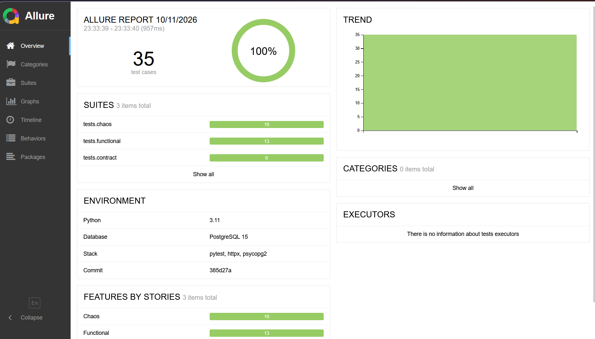

# Transactional API Engine

[](https://github.com/dannyc7765/transactional-api-engine/actions/workflows/api-tests.yml)
[](https://dannyc7765.github.io/transactional-api-engine/)

High-concurrency transactional API built with FastAPI, PostgreSQL row-level locking (`SELECT ... FOR UPDATE`), and token sliding-window middleware.

## System Architecture

```text
+-----------------------------------------------------------------------------------+
|                                Docker Network                                     |
|                                                                                   |
|  +---------------------+        HTTP/REST          +---------------------------+  |
|  |     test-runner     | ------------------------> |            api            |  |
|  |   (pytest-asyncio)  |                           |     (FastAPI/Uvicorn)     |  |
|  +---------------------+                           +---------------------------+  |
|             |                                                    |                |
|             | Direct DB Assertions                               | Connection Pool|
|             | (psycopg2)                                         | (Row Locking)  |
|             v                                                    v                |
|  +-----------------------------------------------------------------------------+  |
|  |                                      db                                     |  |
|  |                            (PostgreSQL 15 Alpine)                           |  |
|  +-----------------------------------------------------------------------------+  |
+-----------------------------------------------------------------------------------+
```

## Test Telemetry & Quality Engineering

Every defect found and fixed during hardening is documented in [INCIDENTS.md](INCIDENTS.md).



Test credentials in `docker-compose.yml` are fixtures for the hermetic test harness. Secret scanning runs in CI (`.gitleaks.toml`).

Interactive execution timelines, test suites, and chaos run logs are deployed on every push:
👉 **[View Live Allure Telemetry Report](https://dannyc7765.github.io/transactional-api-engine/)**

The suite is organized into three tagged suites (`pytest -m chaos|functional|contract`):

* **Chaos (16):** PostgreSQL row-level locking under concurrent load, covering stock (no overselling), wallets (no overdraw) and charging (exactly one buyer is charged). Also JWT boundary faults (expiry, bad signature, `alg=none`), rate limiting, malformed payloads and client timeouts.
* **Functional (13):** Transaction lifecycles verified against both the API response and the database, input validation (negative/zero amounts), and error-code mapping (404/409/422).
* **Contract (6):** Strict response-model validation and typed-client error handling.

## Design Decisions & Known Limitations

* Money is `Decimal` end to end; amounts are validated at the model boundary.
* Lock order is always user -> product to avoid deadlocks.
* The rate limiter is in-process (single worker only); a shared store such as Redis is needed for horizontal scale.
* No idempotency keys: a retried order creates a second order.

## Local Pipeline Execution

Spin up isolated dependencies, await health checks, run functional/contract/chaos test suites, and tear down:

```bash
docker compose up --build --abort-on-container-exit --exit-code-from test-runner
```
